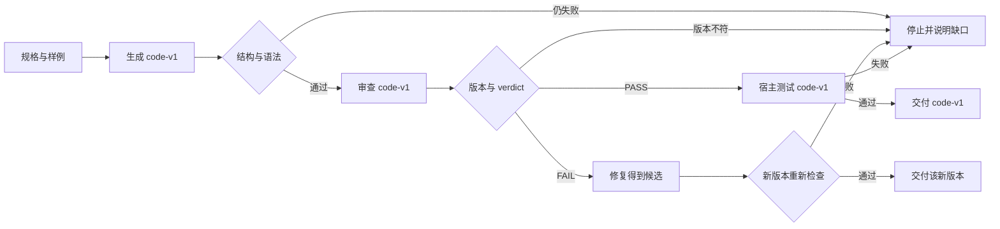

# 《word_counts 函数》Agent 系统设计文档

> 这是示例，不是性能、准确率或兼容性结果。模型输入输出是按交接契约手写的推演，用来展示字段。发布时没有调用模型，没有走一遍宿主门禁，没有给设计打分。得分位置写「留空」。留空不是 0 分，也没有计算平均分。

本文件按 [设计文档模板](../skills/agent-system-design-cn/assets/设计文档模板.md) 写全各节。生产上若只是要得到 `word_counts`，普通 Python 就够，不必使用模型。这里保留完整模板，是为了演示一条已经限定为模型流程的「代码生成 → 审查 → 修复」应当怎样设计。这个前提写在第 11 节，它不构成上线理由。

## 0. 摘要

- 要解决的问题：在示例前提下，把 `word_counts` 的生成、审查和必要修复设计成可校验的固定流程。
- 架构档位：工作流。控制方式是代码编排的固定步骤。任务节点有三个：生成、审查、修复。它们是同一次任务里的三次受约束调用，不是三个 Agent。
- 采用的设计模式（按需，没有就写无）：主模式是提示链。审查结论为 FAIL 时才用评估-优化进入修复；PASS 则不修复。语法检查和固定测试是宿主能力，不是模型工具。异常停止、调用预算和不可信代码边界按路径覆盖。不使用多 Agent 协作。
- 自检综合得分：留空（未评分，未计算均分）。严重问题数量：留空。设计自检分只评文档；本示例连文档分也没有打，实际效果与发布许可另行判断，这里两者都不成立。

## 1. 需求

| 项 | 内容 |
|---|---|
| 输入（来源、格式、规模、质量） | 一份固定规格，见下方原文。另有四条公开字符串和一条非字符串检查。没有外部数据，没有用户私有文本。 |
| 输出（形态、消费者） | 一份 Python 函数源码，外加它所对应的版本号。消费者是宿主的语法检查和固定测试。最终只交付通过这些检查的那一个版本。 |
| 成功标准（可衡量） | 交付版本与被检查版本相同；`ast.parse` 成功；四条样例的返回值与第 10 节草案一致；非字符串抛出 `TypeError`；未检查的版本不得标记为完成。 |
| 时延约束 | 没有测量。不把后面的超时上限写成时延。 |
| 成本约束（单次、月度） | 单次任务最多 3 次模型调用，包含一次格式重试。不估计金额，因为没有选定模型和价格。没有月度预算。 |
| 合规与数据安全 | 规格和样例都是公开示例。提示词中不放密钥。模型没有工具，不能读写文件或访问网络。 |
| 错误后果（可接受程度） | 示例写错只影响这份文档的可读性。设计上仍把错误候选挡在交付之外。不能接受的是把未检查代码或错版本审查说成通过。 |
| 现状（已有系统、数据、工具、人工流程） | 没有现成系统。对照物是一段普通 Python 函数。 |

规格原文，作为每次派发的 `original_goal`：

```text
实现 word_counts(text: str) -> dict[str, int]。单词是连续的 A-Z、a-z、0-9，大小写敏感。标点和其他字符只作分隔，不计入单词。空字符串或没有单词时返回 {}。text 不是字符串时抛出 TypeError。函数不读写文件、不访问网络、不启动子进程。
```

AI 适用性结论：实现这个函数的当前基线是普通代码，信息已经足够，错误可以由测试发现，使用模型会增加费用和错版本风险，并没有相应的业务收益。结论是「不需 AI」。本文件只在第 11 节的临时假设下继续，作为工作流写法的示例；假设没有经过验证，也不授予执行权限。

## 2. 架构选型

- 选定档位：工作流。控制方式是固定步骤，由宿主决定下一步。任务角色不拆成多个 Agent；同一次运行里最多三次模型调用。
- 选择理由：生成、审查、修复之间有明确的产物依赖。审查必须看到原始规格和生成步骤交出的版本；修复必须同时看到规格、原始代码和同一版本的意见。这些步骤和失败出口可以事先写完。
- 为什么不选更简单的一档：若目标是得到函数，普通代码比提示词更简单，而且是正确的生产选择。在「已经限定要演练模型流程」的示例里，单次提示词仍然不够，因为同一次调用不能同时充当候选和独立验收。单 Agent 也不需要，下一步不靠模型看环境后自行决定。多 Agent 不成立，三次调用没有必须隔离的上下文、工具或权限，拆开只有交接成本。
- 性能约束校验：调用次数有硬上限。时延和金额都没有数据，不能判断是否满足某个生产指标。
- 主要风险：把教学示例读成「该函数应当用多 Agent 实现」，或把留空分数读成通过。

选型依据见 [架构选型](../skills/agent-system-design-cn/references/01-架构选型.md)。模式名称只作索引，见 [设计模式索引](../skills/agent-system-design-cn/references/10-设计模式索引.md)。

## 3. 总体架构



编排模式及组合方式：

| 模式 | 用在哪里（主或辅） | 收益及代价 |
|---|---|---|
| 提示链 | 主模式。规格到 code-v1，再到审查意见；只有 FAIL 才到修复 | 每步留下可核对版本。代价是最多三次调用，以及宿主要保管版本 |
| 评估-优化 | 辅助。只在 verdict 为 FAIL 时修复一次 | 有机会按意见改候选。代价是多一次调用；没有意见时不得为了走完流程而修改 |
| 工具使用 | 宿主步骤，不是模型工具。`ast.parse` 与固定测试 | 验收不靠模型自述。代价是要维护测试样例 |
| 异常处理、资源预算、安全边界 | 横切，覆盖全部分支 | 失败、超限和拒绝都有出口。不因此增加 Agent |

编排控制边界：生成完成后才能审查；审查版本匹配并且 verdict 为 FAIL 时才能修复；PASS 时禁止进入修复。没有动态扩写任务，没有并行分支。格式重试最多 1 次，修复不再自动重试。全任务共享 3 次模型调用，用尽即停止。每次模型调用另有 60 秒上限，宿主检查另有 5 秒上限。这两个秒数是设计时写下的上限，不是测量值。

## 4. Agent 定义

按工作流档位，本节写三个 LLM 步骤。没有一个步骤具备独立 Agent 的理由：上下文都是宿主发出的字段，工具白名单都是空的，写权限都是空的。负责派发和接纳的是宿主。争议交回提出需求的人。节点数量是 3，实例数量是 1，角色不是 3 个长期 Agent。

### 4.1 生成

| 项 | 内容 |
|---|---|
| 角色（Role） | 代码生成。只在本步骤使用的任务名，不是持久身份 |
| 目标（Goal） | 按 `original_goal` 写出一个候选函数，并带上版本号 |
| 工作准则或背景（Backstory，无必要内容写不适用） | 不适用。不添加人物背景 |
| 独立存在的理由 | 不适用。它是链上的第一个调用，没有单独的权限或上下文需要隔离 |
| 职责负责人、产物接纳者与争议去向 | 宿主发布 `code-v1` 并做语法接纳。人只在停止后看到缺口 |
| 输入 | 第 7 节的生成派发 |
| 输出结构 | `generated_code` 字符串，`code_version` 字符串 |
| 完成标准与检查机制 | 字段齐全，且 `ast.parse` 成功。模型不检查业务正确性 |
| 停止条件、次数或时间上限及计数口径 | 本次派发最多 1 次模型生成。另允许整个任务内 1 次格式重试，计入 3 次共享预算。单次等待上限 60 秒，这是上限不是测量 |
| 推理方式及理由 | 一次生成。不要求公开思维链，也不做搜索 |
| 模型选择及理由 | 未选定。示例不绑定供应商 |
| 禁止事项 | 调用工具、再派发、声称测试已通过、改写规格 |

### 4.2 审查

| 项 | 内容 |
|---|---|
| 角色（Role） | 代码审查 |
| 目标（Goal） | 对照原始规格和 code-v1 给出意见与 verdict |
| 工作准则或背景 | 不适用 |
| 独立存在的理由 | 不适用。审查不持有生成步骤没有的工具或权限，单独建 Agent 没有隔离收益。它仍然必须是另一次调用，避免候选自己宣布通过 |
| 职责负责人、产物接纳者与争议去向 | 宿主核对 `reviewed_version`。版本不符则丢弃，不交给修复 |
| 输入 | 原始规格、code-v1 全文、版本号 |
| 输出结构 | `review_comments` 字符串数组，`reviewed_version`，以及 `verdict`：`PASS` 或 `FAIL` |
| 完成标准与检查机制 | 结构合法且版本一致。`SUCCESS` 只表示审查返回完整，业务是否通过看 `verdict` |
| 停止条件 | 本次派发 1 次模型调用，等待上限 60 秒。版本不匹配时不再重试 |
| 推理方式 | 对照给定源码和规格。不补充未提供的实现 |
| 模型选择 | 未选定。可以与生成使用同一个模型 |
| 禁止事项 | 修改代码、调用工具、用置信度代替 verdict、审查别的版本 |

### 4.3 修复

| 项 | 内容 |
|---|---|
| 角色（Role） | 代码修复 |
| 目标（Goal） | 只根据 code-v1 和对应的 FAIL 意见产出新候选。没有必须修改的问题时原样返回 |
| 工作准则或背景 | 不适用 |
| 独立存在的理由 | 不适用。修复读的材料来自前两步的已接纳字段，不需要第三套权限 |
| 职责负责人、产物接纳者与争议去向 | 宿主发布新版本号，并只对这个新版本重新做语法检查和测试 |
| 输入 | 原始规格、code-v1、review-v1 的意见和 verdict |
| 输出结构 | `refactored_code`、`refactored_version`、`applied_comments` |
| 完成标准与检查机制 | 有改动则版本必须变化；无改动则版本保持。随后宿主重新检查，旧审查不作废后的新代码的通过证明 |
| 停止条件 | 1 次模型调用，等待上限 60 秒。测试失败不自动再修复 |
| 推理方式 | 按已给意见修改。不重新规划流程 |
| 模型选择 | 未选定 |
| 禁止事项 | 读取其他版本的意见、调用工具、把候选写成已通过 |

## 5. 工具设计

模型的 `tools` 和 `writable` 都是空数组。下表是宿主步骤。模型不能调用它们，也不能用文字模拟它们已经执行。

| 工具 | 使用者 | 描述（功能、产出、何时用、边界） | 参数与校验约束 | 返回、证据及继续读取方式 | 错误与后续去向 | 读写权限 | 风险等级 | 授权或审批与超时 |
|---|---|---|---|---|---|---|---|---|
| `ast.parse` | 宿主 | 检查候选是不是 Python 语法。通过只说明语法，不说明符合规格 | 输入必须是刚接纳的那个版本的源码字符串 | 成功或异常文本。记录版本号 | 失败按该步 gate 处理，不进入下一步 | 只读这份源码 | 低 | 不需人批。5 秒上限 |
| 固定样例执行 | 宿主 | 用标准库把候选函数载入隔离进程，只跑第 10 节的固定样例 | 不允许候选自行选择命令。进程没有密钥，工作目录是空的临时目录 | 每个样例的实际返回值或异常，绑定版本号 | 启动失败或超时按安全失败，不交付 | 只执行这份源码，不写仓库 | 中。执行的是不可信代码 | 示例范围无外部副作用，所以不另设审批人。进程 5 秒后终止 |

接入方式是宿主本地函数。不使用 MCP，也不把本 Skill 当作运行时工具。没有外部服务，没有客户端版本需要声明。

## 6. 上下文与记忆

| 项 | 设计 |
|---|---|
| 有效上下文预算 | 不写 token 数，因为没有选定模型和分词器。规则是每次只放入该步派发中的字段。硬上限是全任务 3 次模型调用 |
| 启动时加载 | `original_goal`、本步输出结构和停止条件。不加载仓库其他文件 |
| 按需来源与检索 | 不检索。材料就是规格和已接纳产物。找不到字段就停止，不改查询条件 |
| 剪枝策略 | 不把上一步的自由文本转发给下一步，只转发已接纳字段 |
| 压缩策略 | 不适用。材料短，不做摘要，避免摘要改写规格 |
| 任务笔记与恢复 | 宿主保存 `task_id`、已接纳版本、verdict、剩余调用次数。本示例不设计进程崩溃后的续跑；中断后的状态视为未完成 |
| 长期记忆 | 不需要。不跨任务保存代码或意见 |
| 子 Agent 上下文隔离 | 不适用。没有子 Agent |

## 7. 协作与交接

三个节点都没有自主循环。宿主的顺序是：派发，等待这一次返回，校验，然后决定停止或进入唯一下一步。没有共享消息总线。

下面的 JSON 是手写推演。其中源码字符串与后面的代码块是同一文本。审查 `status` 为 `SUCCESS` 且 `verdict` 为 `FAIL`，表示审查这份返回是完整的，业务结论是不通过。

### 7.1 交接表

| 上游 | 下游 | 传递字段及可信任务关联 | 依赖的更早产物及版本 | 格式、业务与产物接纳规则 | 失败处理 | 修正或重试上限 |
|---|---|---|---|---|---|---|
| 宿主 | 生成 | 见生成派发。`task_id` 为 `word-counts-example-1` | 无 | 字段齐全且语法可解析才发布 code-v1 | 结构或语法失败可重试当前步 | 1 次，计入共享预算 |
| 生成 | 审查 | `original_goal`、`generated_code`、`code_version` | code-v1 | `reviewed_version` 必须等于 code-v1 | 版本不符则停止，不修复 | 0 |
| 审查 | 修复 | 规格、code-v1、`review_comments`、verdict | code-v1 与 review-v1 | 仅 FAIL 且版本匹配才派发 | PASS 不派发。缺字段则停止 | 0 |
| 修复 | 宿主检查 | `refactored_code` 与新版本号 | 规格、code-v1、review-v1 | 新版本重新做语法检查和样例。code-v1 的审查不能当作 code-v2 的通过 | 检查失败则停止，返回缺口 | 0 |

### 7.2 共享状态与通信

- 方式：一次运行内的内存状态，由宿主直接读写。不使用消息队列、发布订阅或跨系统协议。
- 字段：`task_id`、`original_goal`、`generated_code`、`code_version`、`review_comments`、`reviewed_version`、`verdict`、`refactored_code`、`refactored_version`、`remaining_model_calls`。作用域是这一次任务，进程结束即丢弃。
- 负责人：只有宿主可以写入已接纳字段。三个模型调用只返回文本，不直接改状态。
- 并发：一次只跑一个步骤，没有并发写。重复或迟到的返回若版本对不上当前步骤，丢弃并记一笔拒绝。
- 优先级：不适用。没有排队中的其他任务。

### 7.3 派发契约

没有嵌套委派，深度为 0，不允许模型再派发。三次派发共用 3 次调用预算。契约形状来自 [交接契约模板](../skills/agent-system-design-cn/assets/交接契约模板.json) 的 `dispatch`、`handoff` 和 `gate`。

生成派发：

```json
{
  "identity": {
    "role": "代码生成",
    "expertise": "按书面规格编写一小段 Python"
  },
  "objective": "根据 original_goal 写出 word_counts 的一个候选实现，并给出 code_version。",
  "scope": {
    "readable": [
      "dispatch.context.original_goal"
    ],
    "writable": [],
    "tools": []
  },
  "constraints": [
    "不得调用工具",
    "不得再派发任务",
    "不得声称已经运行测试",
    "受阻时返回 BLOCKED，不要猜测规格外的行为"
  ],
  "context": {
    "original_goal": "实现 word_counts(text: str) -> dict[str, int]。单词是连续的 A-Z、a-z、0-9，大小写敏感。标点和其他字符只作分隔，不计入单词。空字符串或没有单词时返回 {}。text 不是字符串时抛出 TypeError。函数不读写文件、不访问网络、不启动子进程。",
    "background": "宿主会在接纳前做语法检查。这一步只产生候选，不产生通过结论。",
    "prior_findings": [],
    "dependencies": [],
    "standards": "只使用 Python 语言本身，不依赖第三方包。"
  },
  "output_format": "handoff.result = { generated_code: string, code_version: string }",
  "stop_condition": {
    "success": "返回一份结构化候选，或明确 BLOCKED",
    "max_iterations": 1,
    "timeout_seconds": 60,
    "on_blocked": "返回 BLOCKED 与 blockers，不交付代码"
  }
}
```

生成返回：

```json
{
  "task_id": "word-counts-example-1",
  "agent": "generate",
  "status": "SUCCESS",
  "summary": "给出按空白切分的候选 code-v1，尚未经宿主检查。",
  "result": {
    "generated_code": "def word_counts(text: str) -> dict[str, int]:\n    counts = {}\n    for word in text.split():\n        counts[word] = counts.get(word, 0) + 1\n    return counts\n",
    "code_version": "code-v1"
  },
  "artifacts": [
    {
      "name": "generated_code",
      "location": "state.generated_code",
      "producer": "generate",
      "version": "code-v1"
    }
  ]
}
```

可读的 code-v1：

```python
def word_counts(text: str) -> dict[str, int]:
    counts = {}
    for word in text.split():
        counts[word] = counts.get(word, 0) + 1
    return counts
```

审查派发：

```json
{
  "identity": {
    "role": "代码审查",
    "expertise": "对照规格查找候选实现的差距"
  },
  "objective": "对照 original_goal 审查 code-v1，给出意见和 verdict。",
  "scope": {
    "readable": [
      "dispatch.context.original_goal",
      "state.generated_code",
      "state.code_version"
    ],
    "writable": [],
    "tools": []
  },
  "constraints": [
    "不得修改代码",
    "不得调用工具或再派发",
    "reviewed_version 必须等于所读代码的 code_version",
    "不得用自述正确代替 verdict"
  ],
  "context": {
    "original_goal": "实现 word_counts(text: str) -> dict[str, int]。单词是连续的 A-Z、a-z、0-9，大小写敏感。标点和其他字符只作分隔，不计入单词。空字符串或没有单词时返回 {}。text 不是字符串时抛出 TypeError。函数不读写文件、不访问网络、不启动子进程。",
    "background": "审查执行完成不等于验收通过。verdict 为 PASS 或 FAIL。",
    "prior_findings": [
      "生成步骤返回了 code-v1。"
    ],
    "dependencies": [
      {
        "name": "generated_code",
        "location": "state.generated_code",
        "producer": "generate",
        "version": "code-v1"
      }
    ],
    "standards": "意见必须指向规格条款或这段代码，不评价未给出的实现。"
  },
  "output_format": "handoff.result = { review_comments: string[], reviewed_version: string }，并带 verdict",
  "stop_condition": {
    "success": "返回意见数组、所审版本和 PASS 或 FAIL",
    "max_iterations": 1,
    "timeout_seconds": 60,
    "on_blocked": "返回 BLOCKED，不进入修复"
  }
}
```

审查返回：

```json
{
  "task_id": "word-counts-example-1",
  "agent": "review",
  "status": "SUCCESS",
  "summary": "code-v1 未按规格去掉标点，也没有拒绝非字符串。",
  "verdict": "FAIL",
  "result": {
    "review_comments": [
      "text.split() 会把标点留在词里。规格要求标点只作分隔，样例 Hello, hello! 123. 不应得到 Hello, 或 hello!。",
      "规格要求 text 不是字符串时抛出 TypeError。候选实现没有这个检查。",
      "单词只能由 A-Z、a-z、0-9 组成。下划线等其他字符必须分开单词，不能成为单词的一部分。"
    ],
    "reviewed_version": "code-v1"
  },
  "evidence": [
    {
      "source": "state.generated_code code-v1",
      "excerpt": "for word in text.split():",
      "relevance": "切分方式与规格里的单词定义不一致"
    }
  ]
}
```

修复派发：

```json
{
  "identity": {
    "role": "代码修复",
    "expertise": "按已接纳的审查意见修改对应版本的代码"
  },
  "objective": "依据 code-v1 和 review-v1 产出新候选。若没有必须修改的问题，原样返回 code-v1。",
  "scope": {
    "readable": [
      "dispatch.context.original_goal",
      "state.generated_code",
      "state.review_comments",
      "state.reviewed_version"
    ],
    "writable": [],
    "tools": []
  },
  "constraints": [
    "不得忽略 original_goal",
    "不得读取或引用其他版本的审查意见",
    "不得调用工具或再派发",
    "不得把未重新检查的代码写成已通过"
  ],
  "context": {
    "original_goal": "实现 word_counts(text: str) -> dict[str, int]。单词是连续的 A-Z、a-z、0-9，大小写敏感。标点和其他字符只作分隔，不计入单词。空字符串或没有单词时返回 {}。text 不是字符串时抛出 TypeError。函数不读写文件、不访问网络、不启动子进程。",
    "background": "本例 verdict 为 FAIL，所以需要修改。修改后的版本号必须不同于 code-v1。",
    "prior_findings": [
      "审查判定 code-v1 为 FAIL。"
    ],
    "dependencies": [
      {
        "name": "generated_code",
        "location": "state.generated_code",
        "producer": "generate",
        "version": "code-v1"
      },
      {
        "name": "review_comments",
        "location": "state.review_comments",
        "producer": "review",
        "version": "review-v1"
      }
    ],
    "standards": "新代码仍只使用 Python 语言本身。"
  },
  "output_format": "handoff.result = { refactored_code: string, refactored_version: string, applied_comments: string[] }",
  "stop_condition": {
    "success": "返回新候选，或在无问题时原样返回并保持原版本号",
    "max_iterations": 1,
    "timeout_seconds": 60,
    "on_blocked": "返回 BLOCKED 与未能处理的意见"
  }
}
```

修复返回：

```json
{
  "task_id": "word-counts-example-1",
  "agent": "fix",
  "status": "SUCCESS",
  "summary": "按三条意见改写为 code-v2。这仍是候选，宿主尚未重新检查。",
  "result": {
    "refactored_code": "def word_counts(text: str) -> dict[str, int]:\n    if not isinstance(text, str):\n        raise TypeError(\"text must be str\")\n    counts = {}\n    token = []\n\n    def flush():\n        nonlocal token\n        if token:\n            word = \"\".join(token)\n            counts[word] = counts.get(word, 0) + 1\n            token = []\n\n    for ch in text:\n        if (\"A\" <= ch <= \"Z\") or (\"a\" <= ch <= \"z\") or (\"0\" <= ch <= \"9\"):\n            token.append(ch)\n        else:\n            flush()\n    flush()\n    return counts\n",
    "refactored_version": "code-v2",
    "applied_comments": [
      "按字符收集 A-Z、a-z、0-9，其他字符只触发分词。",
      "非字符串抛出 TypeError。",
      "下划线和其他非字母数字字符不再进入单词。"
    ]
  },
  "artifacts": [
    {
      "name": "refactored_code",
      "location": "state.refactored_code",
      "producer": "fix",
      "version": "code-v2"
    }
  ]
}
```

可读的 code-v2：

```python
def word_counts(text: str) -> dict[str, int]:
    if not isinstance(text, str):
        raise TypeError("text must be str")
    counts = {}
    token = []

    def flush():
        nonlocal token
        if token:
            word = "".join(token)
            counts[word] = counts.get(word, 0) + 1
            token = []

    for ch in text:
        if ("A" <= ch <= "Z") or ("a" <= ch <= "z") or ("0" <= ch <= "9"):
            token.append(ch)
        else:
            flush()
    flush()
    return counts
```

三次 gate：

```json
{
  "generate": {
    "required_fields": [
      "task_id",
      "agent",
      "status",
      "summary",
      "result.generated_code",
      "result.code_version"
    ],
    "business_rules": [
      "task_id 必须是 word-counts-example-1",
      "agent 必须是 generate",
      "只有 status 为 SUCCESS 才做 ast.parse",
      "ast.parse 失败不进入审查"
    ],
    "on_fail": "retry_current",
    "max_retries": 1
  },
  "review": {
    "required_fields": [
      "task_id",
      "agent",
      "status",
      "summary",
      "verdict",
      "result.review_comments",
      "result.reviewed_version"
    ],
    "business_rules": [
      "reviewed_version 必须等于已接纳的 code_version",
      "verdict 只能是 PASS 或 FAIL",
      "review_comments 必须是字符串数组",
      "版本不匹配时不调用修复"
    ],
    "on_fail": "escalate_human",
    "max_retries": 0
  },
  "fix": {
    "required_fields": [
      "task_id",
      "agent",
      "status",
      "summary",
      "result.refactored_code",
      "result.refactored_version"
    ],
    "business_rules": [
      "代码有改动时 refactored_version 不得等于 code-v1",
      "verdict 为 PASS 时不得改动代码",
      "ast.parse 通过后才允许跑固定测试",
      "测试未通过不交付"
    ],
    "on_fail": "escalate_human",
    "max_retries": 0
  }
}
```

失败示例：审查返回在结构上完整，但 `reviewed_version` 是 `code-v0`。宿主不调用修复，任务停止。

```json
{
  "task_id": "word-counts-example-1",
  "agent": "review",
  "status": "SUCCESS",
  "summary": "这份返回指向了并不存在的 code-v0。",
  "verdict": "FAIL",
  "result": {
    "review_comments": [
      "标点仍留在单词中。"
    ],
    "reviewed_version": "code-v0"
  }
}
```

停止时宿主返回的交接示意：

```json
{
  "task_id": "word-counts-example-1",
  "agent": "host",
  "status": "BLOCKED",
  "summary": "审查指向的版本不是已接纳的 code-v1。",
  "result": {},
  "blockers": ["reviewed_version code-v0 与 code_version code-v1 不一致，修复未开始"]
}
```

`result` 为空对象，因为这个失败没有可交付代码。模板允许 BLOCKED 带 blockers；业务字段不在失败时伪造。

另一条出口：若审查是 PASS，宿主不派发修复。只有 code-v1 的语法和固定样例都通过，才交付 code-v1。样例失败则返回 PARTIAL，`remaining` 写明哪条样例未满足，不自动改成 FAIL 再修复。

## 8. 人类介入

| 介入点与负责人 | 触发条件 | 实际材料及请求/版本绑定 | 允许决定与审批资格 | 有效期、超时/拒绝及晚到回复处理 | 恢复节点与前置校验 |
|---|---|---|---|---|---|
| 提出需求的人 | 版本不匹配、预算用尽、样例失败或安全检查不能启动 | `task_id`、当前版本、blockers 或 remaining、尚未交付的说明 | 可以结束，或另开一个新 `task_id`。不能口头把旧审查改判为通过 | 本示例不设等待审批的期限，因为失败时流程已经停止。晚到的补充不追溯修改旧结果 | 新任务从生成重新开始，不复用旧的通过结论 |

本示例没有外部发送、删除或付款，所以不设执行前审批。模型的置信度不是批准。已读这份文档也不是批准。若以后允许函数访问网络或文件，需要另做审批设计，本示例的结论不能沿用。

## 9. 可靠性、成本与安全

| 项 | 设计 |
|---|---|
| 错误分类、动作是否发生及允许处理 | 模型调用失败且没有返回：视为没有候选，可在共享预算内重试当前步。已经拿到文本但字段不合法：按 gate 重试或停止。样例进程已启动但结果未知：不重跑第二次去碰运气，先记为未知，任务停止 |
| 初次/追加重试、修正及循环上限 | 生成的格式重试最多 1 次。审查和修复的业务失败不重试。修复本身只允许一次。没有反思循环 |
| 副作用的动作身份 | 唯一副作用是宿主可选地启动样例进程。进程与 `task_id` 加版本号绑定。不写仓库，不发网络请求 |
| 降级 | 不能交付未检查版本来「至少给一段代码」。能给出的只有已接纳材料和明确缺口 |
| 状态保存与断点恢复 | 只保存在本次进程的内存里。不设计恢复后续跑。剩余预算不因设想中的重启而清零，因为本示例根本不恢复 |
| 停止、取消与补偿 | 任一门失败、超时或预算用尽都停止。没有已外发的动作需要补偿。样例进程超时则终止进程 |
| 共享额度 | 3 次模型调用。调用前把剩余次数减 1，返回后不再加回。次数已是 0 时不发起调用。60 秒和 5 秒是上限，不是测量出的耗时，也不是报价 |
| 模型选择及回退 | 未选定，也没有备用模型。不因失败换成另一个未声明的模型 |
| 身份与权限 | 宿主是唯一执行者。模型没有工具，没有写权限。样例进程不带密钥 |
| 安全组件故障 | 语法检查或样例运行器不能启动时拒绝交付，不改成只看模型摘要 |
| 输入边界 | 规格是任务数据。即使样例字符串里出现「忽略规格」一类句子，也只是待统计的文本，不改变 `original_goal` |
| 输出边界 | 交付物是源码和版本号。不输出思维链，不把提示词中的其他材料写入结果 |
| 可观测事件 | 宿主记录 `task_id`、步骤名、版本、gate 结论、是否发起了下一步模型调用、剩余次数、样例进程是否启动。拒绝时下一步的 `model_call_started` 为 false |

## 10. 评测与迭代

| 项 | 设计 |
|---|---|
| 假设与基线 | 临时假设是「要用模型走这条链」。基线是普通函数。该假设未验证，基线也没有做对照实验 |
| 用例来源、版本、数量与覆盖 | 草案 3 组，手写，版本 `cases-v1`。覆盖主路径、边界和失败。没有留出集 |
| 被测边界 | 若将来真的运行，被测对象应是宿主加模型的整条链。本仓库没有这样运行 |
| 评测层级 | 将来应看交付源码、样例终态、版本是否匹配、拒绝时模型是否真的没有被调用。现在没有这些记录 |
| 评分方式 | 样例返回值可以用代码比较。审查意见是否指出真实差距需要另定准则。现在没有评分器，没有正反例校准 |
| 单次或重复试验 | 未运行，不选择 pass@k 或 pass^k，不写成功率 |
| 计划/已运行/有效评分 | 计划 3 组。已运行 0。有效评分 0。分母不是 3 个通过 |
| 基线与候选 | 没有快照对比 |
| 变更门禁 | 未建立。旧审查不能验收新代码；除此之外没有发布流程 |
| 线上指标 | 不适用。没有线上系统 |
| 信号回流 | 不适用。不从本示例学习或微调 |

下表是对照两段示例源码看过的返回值，只说明这两段函数。看过源码不等于执行了本节的评测。

| 输入 | code-v1 | code-v2 |
|---|---|---|
| `Hello, hello! 123.` | `{"Hello,": 1, "hello!": 1, "123.": 1}` | `{"Hello": 1, "hello": 1, "123": 1}` |
| 空字符串 | `{}` | `{}` |
| `...` | `{"...": 1}` | `{}` |
| `a_b` | `{"a_b": 1}` | `{"a": 1, "b": 1}` |
| 非字符串 | code-v1 没有实现 TypeError 检查 | `TypeError` |

评测用例草案（未执行，不表示系统通过）：

| 编号/版本与来源 | 输入及夹具/初态 | 必需标准及可选参考答案 | 类型/风险 | 执行、评分与证据计划 | 草案/实际状态及缺口 |
|---|---|---|---|---|---|
| WC-1 / cases-v1 / 手写 | 规格如上。主样例 `Hello, hello! 123.` | 交付版本的函数返回 `{"Hello": 1, "hello": 1, "123": 1}`，且记录的版本就是被测源码 | 主流程 | 代码比较返回值，并核对版本。不把审查 PASS 当成这个结果 | 草案。未运行，无评分 |
| WC-2 / cases-v1 / 手写 | 空字符串、`...`、`a_b`、非字符串 | 依次为 `{}`、`{}`、`{"a": 1, "b": 1}`、`TypeError`。大小写敏感，`A` 与 `a` 分开 | 边界 | 同上。ASCII 以外的字母不在本组里 | 草案。未运行，无评分 |
| WC-3 / cases-v1 / 手写 | 审查返回 `reviewed_version` 为 `code-v0`，已接纳版本为 code-v1 | 修复步骤的模型调用没有开始；状态为 BLOCKED；不交付 code-v1 或任何修复结果 | 失败 | 查看宿主事件里的 `model_call_started`。缺事件则记为未判定，不算通过 | 草案。未运行，无评分 |

## 11. 待确认事项与假设

| 事项 | 当前假设 | 影响范围 | 需谁确认 |
|---|---|---|---|
| 使用模型完成本函数 | 仅用于演示工作流。生产选择仍是普通代码 | 整份文档的适用性 | 读者不要把它当成业务需求已确认 |
| 单词的字符范围 | 只认 ASCII 字母和数字 | 中文、重音字母会被当成分隔符 | 若规格要改，由提出需求的人另定，并新开版本 |
| 模型、价格、时延 | 未知。60 秒和 5 秒只是上限 | 不能外推性能 | 真正运行前再选，本示例不代选 |
| 审批人 | 失败交回提出需求的人 | 只覆盖无外部副作用的示例 | 一旦有网络或写文件，介入设计作废 |

这些假设未获授权，也未经实测。

## 12. 框架落地（可选）

- 不选用框架。三次调用和两道检查用普通 Python 宿主就能写清。引入 Google ADK、LangGraph、CrewAI 或 AutoGen 不会改变本例的档位。
- 同一契约的字段就是第 7 节的 `task_id`、版本号和结果字段。校验负责人是宿主，不是框架节点。
- 停止计数按模型调用计，不按图的步数计。本示例不保存可恢复状态。
- [框架落地映射](../skills/agent-system-design-cn/references/09-框架落地映射.md) 仍是原资料里的笔记：它记录的材料归档日期是 2026-10-30，补读日期是 2026-11-01，并写明所列版本当时没有安装和测试。本示例没有安装这些包，没有运行该文中的脚手架，也没有重新核对上游现在是否如此。因此这里不填写任何框架版本，不写兼容结论。

## 13. 自检结果

评分者：未评分。本节省略独立评审。适用维度的得分全部留空，所以没有综合得分，没有等级，也不能写通过或未通过。

对照 [设计自检清单](../skills/agent-system-design-cn/assets/设计自检清单.md)，示例类型最接近「工作流」。基础维度里，不需要的能力标为不适用，不打分。

| 维度 | 是否适用 | 得分 | 说明 |
|---|---|---|---|
| 1 任务分解 | 适用 | 留空 | 三个步骤和产物依赖已写明 |
| 2 路由 | 不适用 | 留空 | PASS 与 FAIL 是关卡，不是按类别改派 |
| 3 并行化 | 不适用 | 留空 | 步骤有依赖 |
| 4 反思 | 适用 | 留空 | 只有 FAIL 才修复一次 |
| 5 工具使用 | 适用 | 留空 | 模型工具为空；检查在宿主 |
| 6 规划 | 不适用 | 留空 | 步骤事先固定 |
| 7 多 Agent 协作 | 不适用 | 留空 | 没有多 Agent |
| 8 记忆管理 | 不适用 | 留空 | 不保存长期记忆 |
| 9 学习与适应 | 不适用 | 留空 | 不跨任务更新 |
| 10 异常处理与恢复 | 适用 | 留空 | 有停止出口；不设计续跑 |
| 11 人机协同 | 适用 | 留空 | 失败交回提出需求的人；无外部审批 |
| 12 推理技术 | 不适用 | 留空 | 不指定思维链或搜索 |
| 13 安全防护 | 适用 | 留空 | 不可信代码只在无密钥进程中按固定样例执行 |
| 14 评估与监控 | 适用 | 留空 | 只有草案。已运行 0，有效评分 0 |
| 15 MCP | 不适用 | 留空 | 没有 MCP |
| 16 目标设定与监控 | 不适用 | 留空 | 完成标准在契约里，没有单独监控循环 |
| 17 知识检索 | 不适用 | 留空 | 不检索 |
| 18 Agent 间通信 | 不适用 | 留空 | 没有跨系统通信 |
| 19 资源感知优化 | 适用 | 留空 | 只有共享次数上限，没有价格数据 |
| 20 优先级排序 | 不适用 | 留空 | 没有竞争队列 |
| 21 探索与发现 | 不适用 | 留空 | 规格已经给定 |

适用 8 个，不适用 13 个，待核实 0 个。适用维度的分数仍全部留空，不计入均分。

### 硬性检查

| 检查项 | 结果 | 说明 |
|---|---|---|
| 写明为什么不选更简单的档位 | 文档已写，未运行 | 第 2 节同时写明普通代码才是这个函数的生产选择 |
| 成功标准与主流程、边界、失败草案 | 文档已写，未运行 | 第 10 节三组都标明草案 |
| 停止条件与循环上限 | 文档已写，未运行 | 每步一次，共享 3 次，修复不循环 |
| 交接字段与校验 | 文档已写，未运行 | 第 7 节 |
| 最小权限 | 文档已写，未运行 | 模型没有工具和写权限 |
| 高风险操作的审批或拦截 | 文档已写，未运行 | 本例禁止网络和写文件；执行器故障则拒绝 |
| 成本或调用量上限 | 文档已写，未运行 | 3 次模型调用。没有金额 |
| 失败时可定位 | 文档已写，未运行 | 要求宿主记录版本和是否发起下一步。没有真实日志 |

这些行都不是「通过」。

### 发现的问题

#### 严重

未评分，不能声明严重问题为 0，也不能把本示例标成完成的设计交付。它是候选写法。

#### 中等

没有。ASCII 范围是规格的一部分，不是遗漏；要统计其他文字时应当改规格，而不是在实现里悄悄扩大。

#### 轻微

没有单独列出。未选定模型会阻止任何费用估算，这已作为假设留在第 11 节。

### 识别的反模式

这份示例故意避开的做法：为了显得完整而拆成三个 Agent；审查只看上一步摘要、看不到规格和源码；用同一次调用宣布自己通过；测试失败后无限修复；把未运行的草案算进通过率。

### 改进建议

1. 若目标是得到 `word_counts`，用普通代码实现并测试。原因是规格已闭合。做法是不调用模型。预期收益是去掉版本交接和调用费用。
2. 若仍要演练这条链，先选定一个模型再谈预算。原因是现在没有价格和分词器。做法是把次数上限保留，金额另计。预期收益是预算可以被检查，而不是停留在次数。
3. 真正运行 WC-3 时保存「修复调用没有开始」的事件。原因是只看最终 JSON 无法区分宿主是否守住了 gate。做法是记录 `model_call_started`。预期收益是失败路径可以被审查。

不再追加建议。上面三条都还没有实施，也不改变本页的留空分数。
