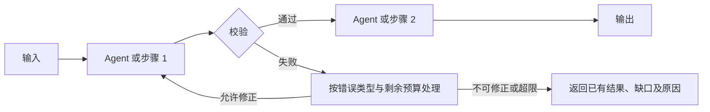

# 《{系统名称}》Agent 系统设计文档

> 确认需要模型后使用本完整模板。普通代码足够时按主流程给出简短结论，无需本模板。使用本模板时保留全部章节，每个章节都要有内容，不适用的写明原因；被主流程裁剪表豁免的章节或表格行，在节首写一句「按某档位裁剪，不适用」即可，无需逐行填写。待确认和临时假设集中列在第 11 节，它们既未获授权，也未经实测。

## 0. 摘要

- 要解决的问题：
- 架构档位：提示词 / 工作流 / 单 Agent / 多 Agent
- 采用的设计模式（按需，没有就写无）：
- 自检综合得分：X.X / 5.0（评分者：同作者自检 / 独立评审），严重问题 N 个；设计自检分只评文档，实际效果与发布许可另行判断

## 1. 需求

| 项 | 内容 |
|---|---|
| 输入（来源、格式、规模、质量） | |
| 输出（形态、消费者） | |
| 成功标准（可衡量） | |
| 时延约束 | |
| 成本约束（单次、月度） | |
| 合规与数据安全 | |
| 错误后果（可接受程度） | |
| 现状（已有系统、数据、工具、人工流程） | |

AI 适用性结论（当前基线、真实价值、信息/授权与风险前提、总成本假设；不需AI/暂缓/限定试点/有证据推进及待验证项）：

## 2. 架构选型

- 选定档位（同时注明控制方式与任务角色或 Agent 数量）：
- 选择理由：
- 为什么不选更简单的一档：
- 性能约束校验（时延、成本是否可接受）：
- 主要风险：

## 3. 总体架构

架构图（推荐 Mermaid 或 PlantUML）：

编排模式及组合方式：

| 模式 | 用在哪里（主或辅） | 收益及代价 |
|---|---|---|

编排控制边界（节点依赖与关卡；适用的允许路由、聚合条件、动态任务与并发上限；回边出口及跨节点总预算）：

## 4. Agent 定义

每个 Agent 一张表。工作流档位中，这一节改为每个 LLM 步骤的定义。

### 4.x {Agent 名称}

| 项 | 内容 |
|---|---|
| 角色（Role） | |
| 目标（Goal） | |
| 工作准则或背景（Backstory，无必要内容写不适用） | |
| 独立存在的理由（实际上下文、工具或权限隔离；简单替代不足与代价；角色、节点、实例计数） | |
| 职责负责人、产物接纳者与争议去向 | |
| 输入 | |
| 输出结构 | |
| 完成标准与检查机制 | |
| 停止条件、次数或时间上限及计数口径 | |
| 推理方式及理由（按需选择，内部思维链无需公开） | |
| 模型选择及理由 | |
| 禁止事项 | |

## 5. 工具设计

| 工具 | 使用者 | 描述（功能、产出、何时用、边界） | 参数与校验约束 | 返回、证据及继续读取方式 | 错误与后续去向 | 读写权限 | 风险等级 | 授权或审批与超时 |
|---|---|---|---|---|---|---|---|---|

接入或组合方式（本地函数、MCP、Skill）及理由；涉及外部服务时注明客户端支持版本、可信认证来源与工具允许清单：

## 6. 上下文与记忆

| 项 | 设计 |
|---|---|
| 有效上下文预算（计数范围、输出预留、软触发与硬上限） | |
| 启动时加载（目标、可信指令、必要状态与导航） | |
| 按需来源与检索（范围、方式、证据引用、无结果及旧版本处理） | |
| 剪枝策略（丢弃什么、证据回读、消息关联保护） | |
| 压缩策略（触发、必留信息、信任边界及失败去向） | |
| 任务笔记与恢复（真实进度、未决事项、产物、动作状态及剩余预算） | |
| 长期记忆（是否需要、准入、来源、作用域、更新、冲突与失效处理） | |
| 子 Agent 上下文隔离（按需说明理由、输入与返回边界） | |

## 7. 协作与交接

有自主循环时写明每轮动作、真实反馈、完成与停止条件。固定工作流及组合模式均定义必要数据交接，即使只有一个模型或 Agent；确无交接、共享状态或子 Agent 时，对应小节写「不适用」及理由。

### 7.1 交接表

| 上游 | 下游 | 传递字段及可信任务关联 | 依赖的更早产物及版本 | 格式、业务与产物接纳规则 | 失败处理 | 修正或重试上限 |
|---|---|---|---|---|---|---|

### 7.2 共享状态与通信

- 方式及必要性（直接调用、共享状态、消息、发布订阅或共享工作区；跨系统协议按需）：
- 字段、键、资源或主题的任务/用户作用域、生命周期与版本：
- 负责人、读取者、允许写入范围与权威发布入口：
- 并发、冲突与适用的消息确认、重复/迟到结果处理：
- 优先级按需说明就绪过滤、规则、平局/最大等待及预算预留，无资源竞争写不适用：

### 7.3 派发契约

每个子 Agent 按 `交接契约模板.json` 的 `dispatch` 七要素写自包含输入，附在此处或附录；下游必要更早产物须可读，返回按 `handoff` 定义具体业务字段，`gate` 规则由宿主实际执行。注明可信任务与实例关联、允许委派关系、最大深度和跨节点共享预算；无嵌套不新增层级或协议。

## 8. 人类介入

| 介入点与负责人 | 触发条件 | 实际材料及请求/版本绑定 | 允许决定与审批资格 | 有效期、超时/拒绝及晚到回复处理 | 恢复节点与前置校验 |
|---|---|---|---|---|---|

人机入口及统一可信记录（可复用受控入口，Manager 按需设置；已读与批准分开，批准与授权分开；停止与接管独立于模型）：

## 9. 可靠性、成本与安全

| 项 | 设计 |
|---|---|
| 错误分类、动作是否发生及允许处理 | |
| 初次/追加重试、修正及循环上限；等待与终止出口 | |
| 必要副作用的动作身份、幂等/去重期限、结果未知核对与冲突处理 | |
| 降级范围、缺口与必须保持的授权/验收条件 | |
| 状态保存与断点恢复（版本、审批、动作、执行所有权与剩余预算） | |
| 停止、取消、迟到结果与适用回滚/补偿；如实记录不可逆动作已发生 | |
| 共享任务额度、计数范围、调用前预留/后结算、软估/硬限及超限出口 | |
| 模型选择及必要回退（质量/隐私/兼容验证，不绕过拒绝） | |
| 可信身份、对象/数据授权、最小工具权限与必要执行隔离 | |
| 必需安全/审计组件故障拒绝及可选遥测故障处理 | |
| 输入防护与外部指令信任边界（规则只是其中一层防线） | |
| 输出、接收者、敏感数据与凭据边界 | |
| 宿主可观测事件、真实拒绝路径验证、脱敏引用与审计保留 | |

## 10. 评测与迭代

| 项 | 设计 |
|---|---|
| 假设与基线、适用性/原型验证及未验证范围 | |
| 用例来源、版本、数量与覆盖；开发/回归/留出及数据治理 | |
| 被测边界、夹具/初态、身份/作用域、重置/隔离、重试/轮次与资源协议 | |
| 评测层级（输出、真实终态、必要过程与资源）；Mock/集成/UAT的证据范围 | |
| 评分方式、版本、正反例、模型评判校准与无效/缺证据处理 | |
| 单次/pass@k/pass^k的选择、运行次数、假设与不确定性；不刷最好结果 | |
| 计划/已运行/有效评分数量、分母、未运行/无效/失败/重跑与覆盖缺口 | |
| 固定基线与候选快照、切片/配对比较、基线及用例/准则变更规则 | |
| 变更触发、必需检查与阈值、绑定版本的待定/阻断/审核/准入；发布与回退权限 | |
| 线上指标口径、窗口、采样、延迟/缺数据、负责人及响应/恢复 | |
| 信号核验、失败分类、复盘五问、根因与提案/验证/批准/生效；自主学习按需引入 | |

评测用例草案（至少 3 条，覆盖主流程、边界、失败场景；草案不表示已执行或系统通过）：

| 编号/版本与来源 | 输入及夹具/初态 | 必需标准及可选参考答案 | 类型/风险 | 执行、评分与证据计划 | 草案/实际状态及缺口 |
|---|---|---|---|---|---|

## 11. 待确认事项与假设

| 事项 | 当前假设 | 影响范围 | 需谁确认 |
|---|---|---|---|

## 12. 框架落地（可选）

- 选用框架、SDK、模型客户端及版本，维护/弃用状态与选用理由；无需框架写明理由：
- 同一派发/交接契约的字段、节点、依赖与校验位置及负责人：
- 停止计数与共享调用预算、审批入口、状态/恢复、真实身份及必要权限映射：
- 构建/接口替身/真实框架与服务验证的证据范围，兼容性及未实现缺口：

## 13. 自检结果

按 `设计自检清单.md` 第 8 节的报告格式，默认直接内嵌在本节：维度评分、硬性检查、不满足与部分满足的检查项明细、问题分级、反模式和改进建议。用户要求完整审计时，另附独立自检文件列出全部检查项。
